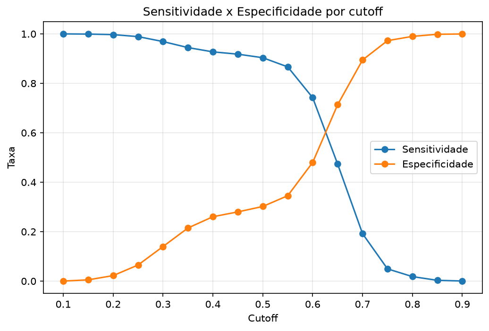

# Regressão Logística - Risco de Encerramento no Varejo


## 🎯 Sobre o projeto

**O problema:** Fintechs que emprestam para pequenos varejistas muitas vezes não têm balanço para analisar. Quem aprova o crédito precisa de algum sinal de risco que exista antes de a empresa ter histórico próprio.

**O que o projeto entrega:** Um modelo de regressão logística que estima, usando só dados cadastrais públicos da Receita Federal, a probabilidade de um estabelecimento varejista ser baixado por encerramento (liquidação, falência ou extinção). A ideia é usar essa probabilidade como mais um sinal de risco, ao lado das informações que a fintech já tem, e não como substituto da análise de crédito. O projeto usa dados públicos e não tem cliente real, então esse uso é um cenário, não um caso aplicado.

**O resultado:** Em uma amostra de teste separada, o modelo tem AUC de 0,65 (validação cruzada: 0,649, desvio de 0,005), ou seja, discrimina de forma moderada. Com corte de 0,62, ele identifica cerca de 66% dos estabelecimentos que foram baixados, ao custo de apontar como risco cerca de 44% dos que seguem ativos. Ser filial (em vez de matriz) e ter menor capital social estão associados a maior risco de encerramento, mas o efeito de filial é menos firme do que parece (veja Limitações).

**Ressalvas:** baixa não é o mesmo que inadimplência, e o modelo usa só dado cadastral, sem histórico financeiro. Por isso ele serve como sinal complementar, não como decisor.

---

## 📖 Como foi feito

- **Dados:** [Dados Abertos de CNPJ](https://dados.gov.br/dados/conjuntos-dados/cadastro-nacional-da-pessoa-juridica---cnpj), Receita Federal (extração de 08/08/2026). Coorte de 1.911.883 estabelecimentos do comércio varejista (CNAE divisão 47) abertos entre 2017 e 2019, da qual extraí uma amostra de 60.000. Depois de separar os grupos de robustez e ruído e de remover os artefatos abaixo, o dataset de modelagem ficou com 45.874 estabelecimentos (59% baixados).
- **Alvo em 4 buckets** (ATIVA, BAIXADA, INAPTA e RUÍDO), cruzando `situacao_cadastral` e `motivo_situacao_cadastral` com a tabela oficial de Motivos, em vez de assumir a classificação.
- **Vazamento de dado:** identifiquei e removi dois casos. A natureza jurídica EIRELI (578 casos, todos baixados, provavelmente efeito da extinção da EIRELI pela Lei 14.195/2021) e as variáveis `optante_simples` e `optante_mei`, cuja opção é cancelada junto com a baixa do CNPJ.
- **Modelo:** regressão logística com 20 termos, reduzida a 18 (7 variáveis) por um Stepwise manual (backward elimination pelo teste de Wald, só com `statsmodels`).
- **Diagnóstico:** matriz de confusão, sensitividade e especificidade por corte, curva ROC, AUC e GINI.
- **Robustez (INAPTA):** extensão minha, não vista no material do curso. Detalhes mais abaixo.
- **Validação fora da amostra** (notebook 07): reestimei o modelo, inclusive o Stepwise, numa amostra de treino e avaliei numa de teste separada, com validação cruzada em 5 partes e checagem de calibração.

<details>
<summary><b>Mais detalhes da metodologia</b></summary>

- A amostra de 60.000 tem estratificação proporcional por risco (preserva a taxa de baixada, não equilibra as classes). Fixei o tamanho e conferi contra a regra de EPV (Peduzzi et al., 1996).
- EIRELI: a explicação que adotei é que a extinção converteu as sobreviventes em outra forma societária. Não testei diretamente essa migração.
- `optante_simples`: a data de exclusão do Simples coincide com a da baixa (mediana de 0 dia).
- Agrupei categorias raras (`natureza_juridica_agrupada`, `regiao`, `grupo_cnae` com 8 grupos de 3 dígitos) e fiz a dummização usando a categoria mais frequente como referência (notebooks 03 e 04).
- O `statstests.process.stepwise` entrou em loop infinito no meu ambiente, por isso implementei o Stepwise na mão.

</details>

---

## 📊 Resultado do modelo final

Na validação fora da amostra (notebook 07), o AUC no teste (0,6545) ficou praticamente igual ao da amostra de estimação (0,6521), o que indica que o modelo não está inflado por sobreajuste.

<p align="center">
  
</p>

**Principais achados:**

- **Filial.** Ser filial tem o maior efeito bruto: coeficiente de +1,17 em relação à matriz, o que dá uma chance de encerramento cerca de 3,2 vezes maior, com as demais variáveis constantes. Esse efeito, porém, depende da natureza jurídica (veja Limitações).
- **Capital social.** O coeficiente de `capital_social_log` é negativo: quanto maior o capital social, menor o risco.
- **Peso relativo.** Em escala padronizada, a natureza jurídica 2062 pesa mais (0,44), seguida de filial (0,27) e de capital social (−0,19).
- **Corte.** No padrão de 0,5 o modelo classifica baixada demais (especificidade de apenas 0,30). O ponto de equilíbrio entre sensitividade e especificidade fica entre 0,60 e 0,65, e usei 0,62 na validação.

<details>
<summary><b>Validação detalhada, comparação dos modelos, calibração e gráfico de cortes</b></summary>

**Validação fora da amostra (notebook 07):**

| Medida | Valor |
|---|---|
| AUC no teste | 0,6545 |
| GINI no teste | 0,309 |
| KS no teste | 0,234 |
| AUC em validação cruzada (5 partes) | 0,649 (desvio de 0,005) |
| Corte de 0,62: sensitividade / especificidade | 0,66 / 0,56 |
| Corte de 0,5: proporção classificada como baixada / especificidade | 82% / 0,30 |

**Comparação dos modelos:**

| Modelo | Descrição | Pseudo R² | AUC* | GINI* |
|---|---|---|---|---|
| `modelo_completo` | 20 termos, antes do Stepwise | 0,0625 | não calculado | não calculado |
| `modelo_step_logit` | **Modelo final**: Stepwise manual, 18 termos (7 variáveis) | 0,0624 | 0,6521 | 0,3042 |
| `modelo_step_robustez` | Refit com o bucket INAPTA tratado como baixada (19 termos) | 0,0535 | 0,6415 | 0,2829 |

\* Calculados na própria amostra de estimação.

`regiao_Norte` e `regiao_Sul` saíram no Stepwise e o Pseudo R² quase não mudou (0,0625 para 0,0624). Todos os 18 termos finais são significativos a 5%.

**Calibração:** as probabilidades são bem calibradas no centro, mas o último decil superestima o risco (0,755 previsto contra 0,709 observado).

<p align="center">
  
</p>

</details>

---

## 🔍 Análise de Robustez (bucket INAPTA)

O bucket INAPTA (12.822 estabelecimentos) mistura empresas em situação cadastral inapta com baixadas por motivos ambíguos (66 e 73), e por isso ficou fora do treino. Para ver se isso mudava alguma coisa, apliquei o modelo final nessas empresas e refiz o Stepwise do zero tratando a INAPTA como baixada. Nenhum coeficiente de preditor trocou de sinal e o AUC caiu de 0,6521 para 0,6415, então excluir a INAPTA não mudou as conclusões do modelo.

<details>
<summary><b>Probabilidades previstas por grupo</b></summary>

| Grupo | Probabilidade prevista (mediana) |
|---|---|
| ATIVA (real) | 0,605 |
| INAPTA (excluída) | 0,638 |
| BAIXADA (real) | 0,646 |

A mediana da INAPTA fica mais perto da BAIXADA do que da ATIVA, mas as três são próximas. As medianas escondem parte da história: a distribuição da ATIVA é bimodal (quartis em 0,385 e 0,658), o que enfraquece a comparação só por medianas. No modelo de robustez só o intercepto muda de sinal, e `regiao_Sul` volta como 19º termo.

<p align="center">
  
</p>

</details>

---

## ⚠️ Limitações

- **Só dado cadastral público.** Sem histórico financeiro ou comportamental, o poder de discriminação tem um teto baixo.
- **Baixa não é inadimplência.** O alvo mede encerramento cadastral, e entre os motivos estão liquidação voluntária e extinção de ME/EPP, que nem sempre significam que o negócio fracassou.
- **O efeito de filial é frágil.** O coeficiente cai de 1,17 para 0,30 quando as linhas da natureza jurídica 2062 saem da base, e só 5% dos estabelecimentos (2.325) são filiais. Tratar "ser filial" como o principal fator de risco exige cautela.
- **Sem validação fora do tempo.** Há uma única extração (2026), e os preditores são os do cadastro atual, medidos depois do desfecho.
- **Dependência entre observações.** Alguns CNPJs aparecem em mais de uma linha e o modelo usa erros padrão comuns, então os p-valores podem ser otimistas.

<details>
<summary><b>Outras limitações</b></summary>

- **Natureza jurídica 2135:** dentro da 2135 (a categoria de referência) a diferença entre filial e matriz é de cerca de 2 pontos percentuais, com apenas 275 filiais.
- **CNPJs repetidos:** são 142 CNPJs básicos repetidos, somando 406 linhas, quase todas filiais.
- **O Stepwise não é estável.** Nas partes da validação cruzada o modelo manteve entre 14 e 18 termos, e no treino o Stepwise removeu 3 termos contra 2 na base completa. A lista exata de variáveis não deve ser lida como definitiva.
- **Previsões concentradas.** A maior parte das probabilidades fica entre 0,6 e 0,7, e no corte de 0,5 o modelo classifica 82% como baixada. O ganho sobre simplesmente "chutar a média" é pequeno (Brier skill de 0,088).
- **Categorias muito pequenas.** "Outras" tem 20 linhas, e as naturezas 2054 e 2046 têm cerca de 100 cada, com intervalos de confiança largos.
- **Capital social com valores extremos.** Há 44 linhas com capital menor ou igual a zero e valores máximos de ordem de 10¹⁰. O `log1p` suaviza, mas os extremos continuam na base.
- **Janela de exposição.** `idade_empresa_anos` é calculada contra uma data fixa (08/08/2026) para toda a coorte, e a faixa de idade é estreita (6,6 a 9,6 anos). O coeficiente positivo pode refletir em parte o tempo de exposição ao risco, e não uma fragilidade maior de empresas mais antigas.
- **Associação, não causalidade.** Os coeficientes descrevem padrões da coorte 2017-2019 observada em 2026.

**Próximo passo:** repetir a validação agrupando por CNPJ e testar erros padrão robustos a esse agrupamento.

</details>

---

## ⚙️ Como Rodar

```bash
pip install -r requirements.txt
jupyter notebook notebooks/01_exploracao_preditores.ipynb
```

Os notebooks devem ser executados em ordem (01 → 07), a partir da pasta `notebooks/`, porque cada um usa os arquivos salvos pelo anterior. Os parquets processados em `data/` estão versionados, então os notebooks rodam sem baixar nada.

<details>
<summary><b>Ambientes, regeneração dos dados e estrutura do repositório</b></summary>

**Ambientes:** os notebooks 01 a 06 foram executados em Python 3.11 com pandas 3.0.5, numpy 2.4.6, statsmodels 0.14.6 e scikit-learn 1.9.0. O notebook 07 foi executado em um ambiente separado, com pandas 2.3.3, numpy 2.2.6, statsmodels 0.15.0 e scikit-learn 1.7.2. O `requirements.txt` fixa o statsmodels em **0.14.6** porque o modelo salvo em `data/modelo_final_logit.pickle` não funciona no 0.15.0 (o notebook 06 usa `summary()` e `predict()` sobre ele). Com o 0.14.6, pandas 2.3.3 e scikit-learn 1.7.2, o resultado do 07 se reproduz (AUC de teste 0,6545 e KS 0,234) e a pontuação do bucket INAPTA do notebook 06 dá a mesma mediana (0,638). Ao reproduzir, pequenas diferenças numéricas são possíveis.

**Dados:** a pasta `data/raw/` (extrações brutas) e o `cohort_varejo_completo.parquet` não estão no repositório. Para regenerá-los, baixe os arquivos da Receita Federal (link na seção "Como foi feito"), coloque-os como abaixo e rode os scripts de `src/` **a partir da raiz do repositório**, nesta ordem:

| Passo | Script | Lê | Gera |
|---|---|---|---|
| 1 | `pipeline_extracao.py` | `data/raw/Estabelecimentos0.zip` a `Estabelecimentos9.zip` | `data/raw/cohort_estabelecimentos0..9.parquet` |
| 2 | `situacao_cadastral.py` | os parquets do passo 1 | `data/cohort_varejo_completo.parquet` |
| 3 | `preparacao_amostra.py` | a coorte do passo 2 | `data/amostra_varejo_60k.parquet` |
| 4 | `cruzamento_empresas.py` | a coorte e `data/raw/empresa/*.EMPRECSV` | `data/raw/empresa/cohort_empresas.parquet` |
| 5 | `cruzamento_simples.py` | a coorte e `data/raw/simples/*SIMPLES*` | `data/raw/simples/cohort_simples.parquet` |
| 6 | `dataset_modelagem.py` | passos 3, 4 e 5 | `data/dataset_modelagem.parquet` |
| 7 | `redefinir_alvo.py` | o dataset do passo 6 | `data/dataset_modelagem_baixada.parquet` e os parquets de robustez e ruído |

Os passos 4 e 5 só dependem do passo 2, então podem rodar antes do 3. Detalhes de cada arquivo em `data/README.md`.

**Estrutura:**

    supervised-learning-varejo-logistica/
    ├── data/
    │   ├── README.md
    │   ├── amostra_varejo_60k.parquet
    │   ├── dataset_modelagem.parquet
    │   ├── dataset_modelagem_baixada.parquet
    │   ├── dataset_modelagem_final.parquet
    │   ├── dataset_excluidos_robustez.parquet
    │   ├── dataset_excluidos_ruido.parquet
    │   ├── df_modelo_treino.parquet
    │   ├── probs_treino.parquet
    │   ├── perfil_colunas_dataset_modelagem.csv
    │   └── modelo_final_logit.pickle
    ├── notebooks/
    │   ├── 01_exploracao_preditores.ipynb
    │   ├── 02_exclusao_artefato_eireli.ipynb
    │   ├── 03_agrupamento_natureza_juridica.ipynb
    │   ├── 04_agrupamento_uf_cnae.ipynb
    │   ├── 05_estimacao_modelo.ipynb
    │   ├── 06_analise_robustez_inapta.ipynb
    │   └── 07_validacao.ipynb
    ├── src/
    │   ├── pipeline_extracao.py
    │   ├── cruzamento_empresas.py
    │   ├── cruzamento_simples.py
    │   ├── situacao_cadastral.py
    │   ├── preparacao_amostra.py
    │   ├── dataset_modelagem.py
    │   └── redefinir_alvo.py
    ├── outputs/
    │   ├── curva_roc.png
    │   ├── sensitividade_especificidade_cutoff.png
    │   └── robustez_boxplot_inapta.png
    ├── requirements.txt
    ├── .gitignore
    └── README.md

</details>
