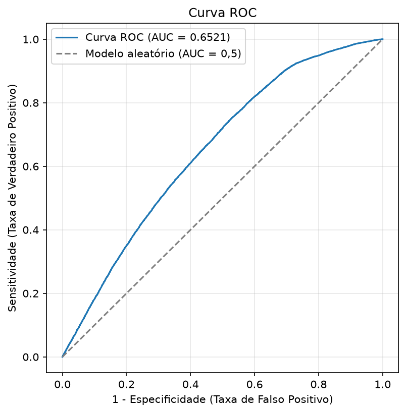
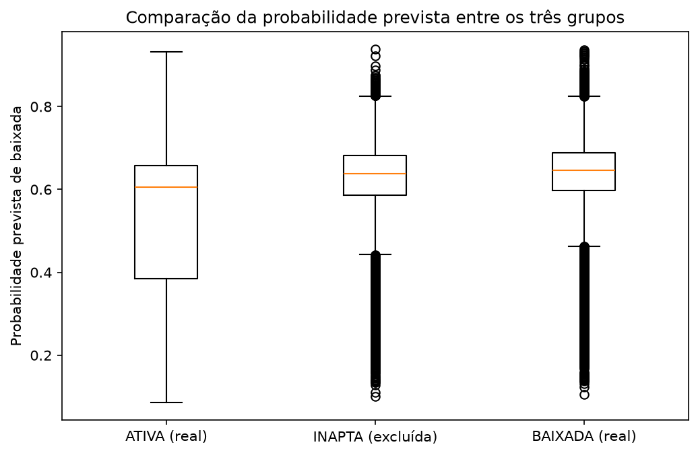

# Regressão Logística - Risco de Encerramento no Varejo


## 🎯 Sobre o projeto

Fintechs que emprestam para pequenos varejistas muitas vezes não têm balanço para analisar. Neste projeto estimei, usando só dados cadastrais públicos da Receita Federal, a probabilidade de um estabelecimento varejista ser baixado (liquidação, falência ou extinção). A ideia é usar essa probabilidade como mais um sinal de risco na análise de crédito, junto com as outras informações que a fintech já tem.

O modelo final tem AUC de 0,65 na amostra de modelagem. Ser filial (em vez de matriz) e ter menor capital social aumentam o risco de encerramento.

Algumas ressalvas: baixa não é o mesmo que inadimplência; o projeto usa dados públicos e não tem cliente real, então a aplicação em crédito é um cenário possível; e todas as métricas foram calculadas na mesma amostra usada para estimar o modelo (veja [Limitações](#️-limitações)).

---

## 📖 Etapas do Projeto

### 1. Coleta dos Dados

- **Fonte:** [Dados Abertos de CNPJ](https://dados.gov.br/dados/conjuntos-dados/cadastro-nacional-da-pessoa-juridica---cnpj), Receita Federal (extração de referência: 08/08/2026)
- **Arquivos:** Estabelecimentos, Empresas, Simples/MEI, Motivos e Naturezas (tabelas oficiais de referência código → descrição)
- **Coorte:** estabelecimentos com CNAE principal na divisão 47 (Comércio Varejista), abertos entre 2017 e 2019, num total de 1.911.883
- **Amostra para modelagem:** 60.000, estratificada por risco e justificada por EPV (Peduzzi et al., 1996)

### 2. Metodologia

- Defini o alvo em 4 buckets (ATIVA, BAIXADA, INAPTA e RUÍDO), cruzando `situacao_cadastral` e `motivo_situacao_cadastral` com a tabela oficial de Motivos, em vez de assumir a classificação.
- Encontrei dois casos de vazamento de dado e tirei essas variáveis do modelo:
  - **EIRELI:** natureza jurídica extinta pela Lei 14.195/2021, o que gerou 100% de encerramento artificial na amostra.
  - **`optante_simples` e `optante_mei`:** a opção é cancelada automaticamente quando o CNPJ é baixado.
- Agrupei categorias raras (`natureza_juridica_agrupada`, `regiao`, `grupo_cnae`) e fiz a dummização usando a categoria mais frequente como referência. Detalhes nos notebooks 03 e 04.
- Estimei o modelo completo com 20 preditores e depois fiz o **Stepwise manual** (backward elimination pelo teste de Wald, só com `statsmodels`). Tive que implementar na mão porque o `statstests.process.stepwise` entrou em loop infinito no meu ambiente.
- No diagnóstico usei matriz de confusão, sensitividade e especificidade por cutoff, curva ROC, AUC e GINI.
- Fiz uma análise de robustez no bucket INAPTA, que é uma extensão minha e não foi vista no material do curso.

### 3. Resultado do Modelo Final

| Modelo | Descrição | Pseudo R² | AUC* | GINI* |
|---|---|---|---|---|
| `modelo_completo` | 20 preditores, antes do Stepwise | 0,0625 | não calculado | não calculado |
| `modelo_step_logit` | **Modelo final**: Stepwise manual, 18 preditores | **0,0624** | **0,6521** | **0,3042** |
| `modelo_step_robustez` | Refit com o bucket INAPTA tratado como baixada | 0,0535 | 0,6415 | 0,2829 |

\* AUC e GINI calculados na própria amostra de estimação, sem validação fora da amostra.

O modelo final ficou com 18 das 20 variáveis, todas significativas a 5%. `regiao_Norte` e `regiao_Sul` saíram no Stepwise e o Pseudo R² quase não mudou (0,0625 para 0,0624). A discriminação é moderada, o que faz sentido para um modelo que só usa dado cadastral público, sem histórico financeiro. Modelos com dados de bureau de crédito costumam discriminar melhor.

<p align="center">
  
</p>

**Principais achados:**

- **Ser filial** tem o maior efeito: coeficiente de +1,17 em relação à matriz, o que dá uma chance de encerramento cerca de 3,2 vezes maior, com as demais variáveis constantes.
- **`capital_social_log`** tem coeficiente negativo: quanto maior o capital social, menor o risco.
- **Cutoff:** no padrão de 0,5 o modelo classifica baixada demais (especificidade de apenas 0,30). O ponto de equilíbrio entre sensitividade e especificidade fica em torno de 0,62-0,63.

---

## 🔍 Análise de Robustez (bucket INAPTA)

O bucket INAPTA (situação cadastral ambígua, 12.822 empresas) ficou fora do treino porque não é claramente ativa nem baixada. Para ver se isso mudava alguma coisa, apliquei o modelo final nessas empresas (`.predict()`) e comparei com os grupos reais:

<p align="center">
  
</p>

| Grupo | Probabilidade prevista (mediana) |
|---|---|
| ATIVA (real) | 0,605 |
| INAPTA (excluída) | 0,638 |
| BAIXADA (real) | 0,646 |

A mediana da INAPTA fica mais perto da BAIXADA do que da ATIVA, mas as três são próximas. Depois refiz o Stepwise do zero tratando a INAPTA como alvo = 1 (linha `modelo_step_robustez` da tabela). Nenhum coeficiente trocou de sinal e o AUC caiu cerca de 1,6% (0,6521 para 0,6415). Ou seja, excluir a INAPTA não muda as conclusões do modelo.

---

## ⚠️ Limitações

- **Não fiz validação fora da amostra.** Matriz de confusão, ROC, AUC e cutoff foram calculados na mesma base em que estimei o modelo, e o Stepwise também escolheu as variáveis nela. Por isso o AUC de 0,65 deve estar um pouco otimista. Com 45 mil observações e 18 preditores acredito que a diferença seja pequena, mas não verifiquei.
- **Só dado cadastral público.** Sem histórico financeiro ou comportamental, o poder de discriminação tem um teto baixo.
- **Baixa não é inadimplência.** O alvo mede encerramento cadastral, e entre os motivos estão liquidação voluntária e extinção de ME/EPP, que nem sempre significam que o negócio fracassou.
- **Janela de exposição.** `idade_empresa_anos` é calculada contra uma data fixa de referência para toda a coorte, então o coeficiente positivo pode refletir em parte o tempo de exposição ao risco, e não uma fragilidade maior de empresas mais antigas.
- **Associação, não causalidade.** Os coeficientes descrevem padrões da coorte 2017-2019 observada em 2026.

**Próximo passo:** refazer a estimação (incluindo o Stepwise) numa amostra de treino e avaliar AUC e matriz de confusão numa amostra de teste separada.

---

## ⚙️ Como Rodar

```bash
pip install -r requirements.txt
jupyter notebook notebooks/01_exploracao_preditores.ipynb
```
Os notebooks devem ser executados em ordem (01 → 06), porque cada um usa os arquivos salvos pelo anterior.

<details>
<summary><b>📁 Estrutura do repositório</b></summary>

    sl-varejo-log/
    ├── data/
    │   ├── raw/                                  # extrações brutas da Receita
    │   ├── dataset_modelagem_final.parquet
    │   ├── df_modelo_treino.parquet
    │   ├── probs_treino.parquet
    │   └── modelo_final_logit.pickle
    ├── notebooks/
    │   ├── 01_exploracao_preditores.ipynb
    │   ├── 02_exclusao_artefato_eireli.ipynb
    │   ├── 03_agrupamento_natureza_juridica.ipynb
    │   ├── 04_agrupamento_uf_cnae.ipynb
    │   ├── 05_estimacao_modelo.ipynb
    │   └── 06_analise_robustez_inapta.ipynb
    ├── outputs/
    │   ├── curva_roc.png
    │   ├── sensitividade_especificidade_cutoff.png
    │   └── robustez_boxplot_inapta.png
    ├── src/
    │   ├── pipeline_extracao.py
    │   ├── preparacao_amostra.py
    │   ├── cruzamento_empresas.py
    │   ├── cruzamento_simples.py
    │   ├── redefinir_alvo.py
    │   └── dataset_modelagem.py
    ├── requirements.txt
    └── README.md

</details>
